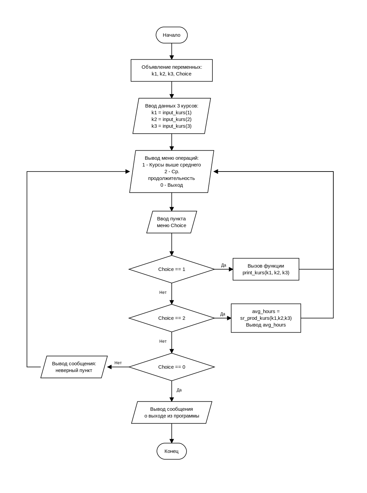

# Домашнее задание к работе 11.
## Вариант 8.
Поля записи:
  название курса
  категория
  продолжительность в часах
  стоимость
  формат обучения
Определить среднюю продолжительность курсов и вывести сведения о курсах, продолжительность которых выше средней.

## 1. Алгоритм и блок-схема.
1. Начало
2. Обьявление структуры kurs и функций.
3. Ввод данных для 3 курсов
4. Меню через do-while
5. Ввод операции Choice
6. Выполнение операции в switch(choice)
7. Проверка условия конца цикла меню
8. Конец

### Блок-схема


## 2. Реализация программы.
[Код программы](Lab11.Home.c)

## 3. Результаты работы 
``` text
Введите данные для 3 курсов:
Ввод данных курса 1:
Введите название курса: Python
Введите категорию курса: IT
Введите количество часов: 120
Введите стоимость курса: 45000
Введите формат курса: Онлайн
Ввод данных курса 2:
Введите название курса: Веб-разработка
Введите категорию курса: Программирование
Введите количество часов: 80
Введите стоимость курса: 30000
Введите формат курса: Очный
Ввод данных курса 3:
Введите название курса: Дизайн
Введите категорию курса: Графика
Введите количество часов: 40
Введите стоимость курса: 20000
Введите формат курса: Онлайн
====Меню====
1. Вывод данных курсов, продолжительность которых больше средней
2. Вычисление средней продолжительности курса
0. Выход
Выберите действие: 2
Средняя продолжительность курса: 80.00 часов
====Меню====
1. Вывод данных курсов, продолжительность которых больше средней
2. Вычисление средней продолжительности курса
0. Выход
Выберите действие: 1
Python курс имеет продолжительность больше средней
====Меню====
1. Вывод данных курсов, продолжительность которых больше средней
2. Вычисление средней продолжительности курса
0. Выход
Выберите действие: 0
Выход из программы
```

## Информация о разработчике.
Гуров Е.А. бОТИ-261 1п/г.
